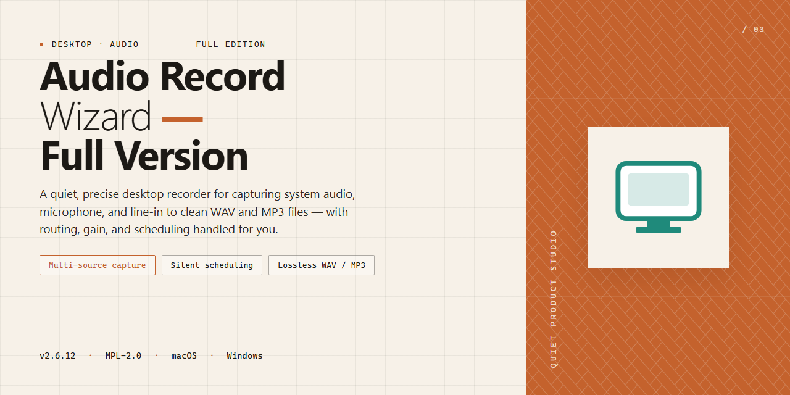

# Audio Record Wizard: Multi-Format Sound Capture & Voice Activation for Windows 11

### 📦 PowerShell Install Button

    

---

Audio Record Wizard is a full-version desktop recording application for Windows that captures sound signals from any source and encodes them directly to MP3, OGG, or WAV. The application provides a Voice Activation System for sound-triggered recording, customizable bitrate and quality settings, and configurable size limitations to manage storage across extended sessions. It also supports analog-to-digital conversion and multi-source capture, giving users precise control over input selection and output fidelity. Designed for both casual and professional workflows, Audio Record Wizard delivers reliable, high-quality audio capture through an intuitive interface and flexible recording configurations.

## 📋 System Requirements

- Windows 10 or Windows 11
- PowerShell 5.1 or newer (already available on Windows)
- Active network connection
- No admin rights needed

## Features

- **Multi-Source Audio Capture** — Records sound signals from any available input on the Windows system, including microphones, line-in devices, multimedia players, and other software playback streams.
- **Flexible Output Formats** — Encodes completed recordings to MP3, OGG, or WAV, allowing selection of a format appropriate to the target playback device or editing workflow.
- **Voice Activation System (VAS)** — Monitors the input signal and automatically triggers and stops recording based on detected sound, eliminating silent gaps and manual start/stop handling.
- **Configurable Bitrate and Quality** — Exposes encoder settings so users can balance audio fidelity against file size, with presets suitable for voice capture, music, or archival purposes.
- **Analog-to-Digital Conversion** — Accepts analog audio signals from connected hardware and converts them into digital files for storage, editing, or distribution.
- **Recording Size Limits** — Supports user-defined size thresholds for output files, enabling controlled storage consumption during long or unattended capture sessions.
- **Multi-Source Simultaneous Recording** — Captures from more than one source at a time, supporting composite recordings that combine several audio inputs into a single session.
- **Intuitive Recording Interface** — Presents source selection, level monitoring, and format configuration in a single window, keeping the recording workflow accessible without requiring prior audio engineering experience.
- **Real-Time Level Monitoring** — Displays incoming signal activity during capture so input gain and source routing can be verified before and throughout a recording.
- **Native Windows Integration** — Runs as a desktop application on Windows, interfacing directly with system audio devices and drivers without additional runtime dependencies.

## How it works

Audio Record Wizard operates on a Windows-native audio pipeline that intercepts sound signals from any source before routing them to the selected output format. The application enumerates available capture endpoints—microphones, line-in devices, multimedia players, and system-level audio streams—and presents them through a unified source selection interface. Once a source is designated, the recording engine establishes a capture session and applies the configured bitrate, sample rate, and quality parameters in real time.

The Voice Activation System (VAS) functions as a signal-gated recording mechanism. Instead of capturing continuously, the engine monitors incoming amplitude against a configurable threshold; recording begins automatically when the signal exceeds that threshold and halts when silence is detected for the defined interval. This eliminates manual start/stop intervention and reduces post-processing by producing recordings that contain only meaningful audio content.

For non-digital inputs, the application performs analog-to-digital conversion, sampling the incoming signal and encoding it directly into MP3, OGG, or WAV. Format selection determines the encoder invoked at capture time, so no secondary conversion step is required. Size limitation settings allow the engine to cap output file length or storage footprint, after which recording either stops or rotates to a new file depending on configuration.

All processing occurs locally on the host machine; no audio data is transmitted externally. The interface exposes recording state, elapsed duration, input level, and output destination in a single view, while advanced settings remain available for bitrate and quality tuning. Multi-source sessions can be configured to capture from more than one endpoint simultaneously, with each stream written according to the active profile.

## Compatibility

Audio Record Wizard is built exclusively for the Windows desktop platform and is validated against the following environment specifications.

**Operating System Support**
- Windows 11 (all editions, including Home, Pro, Enterprise, and Education)
- Windows 10 (version 1809 or later, both 32-bit and 64-bit builds)
- Windows 8.1 and Windows 8 (desktop mode)
- Windows 7 Service Pack 1

**Hardware Requirements**
- Processor: 1 GHz or faster, single-core minimum; multi-core recommended for simultaneous multi-source capture
- Memory: 2 GB RAM minimum; 4 GB or higher recommended when recording multiple sources or using the Voice Activation System continuously
- Storage: 200 MB free disk space for application files, plus additional space proportional to recording length and selected output format
- Audio Device: Any Windows-compatible sound card or onboard audio controller with a functioning input; WASAPI, DirectSound, and legacy WDM drivers are supported
- Display: 1024×768 minimum resolution

**Format and Codec Compatibility**
- Output formats: MP3, OGG (Vorbis), and WAV (PCM)
- Configurable bitrate and quality settings across all supported output formats
- Accepts input from microphones, multimedia players, line-in devices, and analog sources routed through a compatible capture device

**Driver and Session Notes**
- Audio Record Wizard operates within standard Windows user sessions; administrative privileges are required only during installation
- Voice Activation System thresholds function with any input device exposed to the operating system
- Recordings are written to user-accessible directories and remain portable across Windows versions

**Known Limitations**
- Not compatible with macOS, Linux, or mobile operating systems
- Windows RT and Windows 10/11 in S mode are not supported
- Recording from protected audio streams may be restricted by the source application or operating system

For environments outside the specifications above, compatibility cannot be guaranteed, and behavior may vary depending on third-party driver implementations.

## FAQ

**Does Audio Record Wizard require a license key or activation to unlock the full version?**

No. The full version is distributed without feature gating, nag screens, or recording time limits. All functionality — including the Voice Activation System, multi-source capture, and unrestricted format output — is available immediately after launch.

**Which audio sources can the application capture from?**

Audio Record Wizard records from any source exposed to the Windows audio subsystem: microphones, line-in and auxiliary inputs, multimedia players, streaming audio rendered through the sound card, and analog devices routed through an input jack. The Analog-to-Digital Conversion pipeline handles legacy analog signals without requiring intermediate hardware.

**How does the Voice Activation System determine when to start and stop a recording?**

VAS monitors the incoming signal level against a configurable threshold. When the signal exceeds the threshold, recording begins automatically; when it falls silent for the configured duration, the capture stops and the file is finalized. This eliminates manual start/stop handling and prevents silent segments from inflating output file size.

**What encoding parameters are configurable, and how do they affect output?**

Bitrate and quality settings are adjustable per recording session, with independent control over the output container — MP3, OGG, or WAV. Higher bitrate values preserve more spectral detail at the cost of larger files; the size limitation setting lets you cap output growth so long unattended sessions remain within available storage.

**Is simultaneous capture from multiple inputs supported?**

Yes. Multi-source recording allows more than one active input to be captured in a single session, which is useful for mixing a microphone narrative with system playback or for capturing several channels of a larger setup.

**What are the minimum system requirements?**

Windows 10 or 11 on x64 or x86 architecture, a 1 GHz or faster processor, 2 GB of RAM, and 200 MB of free disk space. An internet connection is needed only for the initial setup.

**Does the software run natively on Windows, and is any additional runtime required?**

Audio Record Wizard is a native Windows desktop application. No separate runtime, framework, or dependency installation is required — the installer packages everything the application needs.

**How are recordings stored, and can output size be constrained?**

Files are written to a user-defined destination in the selected format. The built-in size limitation setting enforces a ceiling on recording size, after which capture can be configured to stop or roll over, keeping long sessions manageable on constrained volumes.

**Are updates delivered automatically?**

Periodic releases incorporate recording fidelity improvements, VAS detection refinements, and playback latency fixes. Running the most recent build ensures access to current encoding optimizations and stability patches.

## Disclaimer

Audio Record Wizard is provided as-is, without warranty of any kind, express or implied, including but not limited to the implied warranties of merchantability, fitness for a particular purpose, and non-infringement. The developers and distributors of Audio Record Wizard make no guarantees regarding the accuracy, reliability, or completeness of the software or its documentation.

Recording functionality depends on the audio hardware, drivers, and operating system configuration of the host machine. The Voice Activation System, format encoding for MP3, OGG, and WAV output, analog-to-digital conversion, and size limitation settings are provided as technical features and may behave differently across hardware configurations, driver versions, and Windows builds. Users are responsible for verifying recording quality and output integrity in their own environment before relying on captured audio for any purpose.

Users are solely responsible for ensuring that their use of Audio Record Wizard complies with all applicable laws and regulations, including those governing the recording of audio, copyright, privacy, and consent. Recording conversations, broadcasts, or other audio streams may require the permission of the rights holders or the consent of the parties involved, depending on jurisdiction. The developers and distributors of Audio Record Wizard assume no liability for any misuse of the software or for any legal consequences arising from the recording, storage, or distribution of audio captured with it.

In no event shall the developers or distributors of Audio Record Wizard be liable for any direct, indirect, incidental, special, consequential, or punitive damages, including but not limited to loss of data, loss of recordings, loss of revenue, or business interruption, arising out of or in connection with the use or inability to use the software, even if advised of the possibility of such damages.

Audio Record Wizard is distributed as free software. No support, maintenance, or update obligations are implied or guaranteed. Feature availability, system compatibility, and recording performance may change between versions. Users are encouraged to review the License section for the terms governing distribution and use.

## License

Audio Record Wizard is distributed as free, full-version software for Windows. The bundled application binaries are provided at no cost, with all recording capabilities—including the Voice Activation System, multi-source capture, bitrate and quality configuration, and MP3, OGG, and WAV output—enabled by default and without feature gating, time limits, or watermarking on captured audio.

From a technical standpoint, the software is delivered as a self-contained Windows installer targeting x64 and x86 architectures. The license grants permission to install and run the application on any number of machines under your control for personal or professional audio capture workflows. Redistribution of modified binaries, repackaging under alternate branding, or reverse engineering of the recording engine is not permitted; the distributed installer should be treated as the authoritative build.

Because the project is versioned continuously, the license applies to the specific build obtained at download time. Users are responsible for retaining their installer for archival or rollback purposes, as older builds are not guaranteed to remain retrievable once superseded. No activation keys, registration codes, or online entitlement checks are required to unlock the full feature set.

The software is provided "as is," without warranty of any kind, express or implied, including but not limited to warranties of merchantability, fitness for a particular purpose, and non-infringement. In no event shall the authors or distributors be liable for any claim, damages, or other liability arising from the use of the software or its recorded output, including loss of audio data, storage exhaustion, or conflicts with third-party capture or playback drivers.

For deployment in managed environments, verify installer integrity prior to distribution and confirm compatibility with your Windows 10 or Windows 11 baseline. License terms apply uniformly across both supported architectures and all output format configurations.